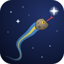

# PySyzygos 
[](https://doi.org/10.5281/zenodo.23149371)

> **The name.** *Syzygos* (Greek σύζυγος, *sýzygos*) means "yoked together", from *syn* "together" and *zygón*
> "yoke". From it come Late Latin *syzygia* and the astronomers' *syzygy*: three celestial bodies in a straight line.
> An occultation is one: for a few seconds the observer, the asteroid and the star stand in one line. Up to version
> 0.18 the project was called PyOccult.

Python Occultation Searcher by PyZahl (C) 2026, version 1.3.1 “Beyond Horizons”. Free software under the GNU GPL v3 or later (see License below).
The version and its code name (it changes at major milestones) are kept in `pysyzygos/version.py`; the GUI header and
its **About** box show both, the report and `--version` of every tool show the version. What changed in each version:
[CHANGELOG.md](CHANGELOG.md). How the predictions were verified: [VERIFICATION.md](VERIFICATION.md).

Experimental occultation search tool for asteroids, planets and their moons, built with Python, Astropy, SpiceyPy and
NiceGUI: a local web interface to plan and run all tasks for easy event exploration. New here? Start with the
[Quick start](#quick-start).

## Contents

- [What is it?](#what-is-it)
- [Occultation Data](#occultation-data)
- [Tools in this project](#tools-in-this-project)
- [Quick start](#quick-start)
- [Install](#install)
  - [Easiest: with uv (Linux, macOS, Windows)](#easiest-with-uv-linux-macos-windows)
  - [Windows, step by step (with uv)](#windows-step-by-step-with-uv)
  - [With pip and a virtual environment](#with-pip-and-a-virtual-environment)
- [Python Virtual Environment Setup Guide](#python-virtual-environment-setup-guide)
  - [1. Create the Virtual Environment](#1-create-the-virtual-environment)
  - [2. Activate the Virtual Environment](#2-activate-the-virtual-environment)
  - [3. Install PySyzygos](#3-install-pysyzygos)
  - [4. One-time data setup](#4-one-time-data-setup)
  - [5. Run it: the web interface](#5-run-it-the-web-interface)
    - [The core command-line tools](#the-core-command-line-tools)
  - [Quick Tips](#quick-tips)
- [If something goes wrong: start over](#if-something-goes-wrong-start-over)
- [Where your data and settings live](#where-your-data-and-settings-live)
- [Site Configuration and Run Setup](#site-configuration-and-run-setup)
- [Star catalog (required)](#star-catalog-required)
- [Pick tool: choose targets](#pick-tool-choose-targets)
- [Web interface (GUI)](#web-interface-gui)
- [Planets and moons](#planets-and-moons)
- [Report: event list, maps and previews](#report-event-list-maps-and-previews)
- [GUI Step by Step in Screenshots](#gui-step-by-step-in-screenshots)
- [Contributing](#contributing)
- [License](#license)
- [Acknowledgements](#acknowledgements)
- [References](#references)

## What is it?
Scientific background, start here; International Occultation Timing Association (IOTA):

- IOTA: https://occultations.org

- Background: https://occultations.org/occultations/what-is-an-occultation

- OWC: https://cloud.occultwatcher.net

### What is an Occultation?
An occultation occurs when a solar-system body passes in front of a more distant object (e.g. a star or another solar system body), partially or totally hiding the more distant object and momentarily blocking its light. Each occultation can be seen only at the right time and from a limited part of the Earth.

### Citing from IOTA: Asteroid Occultations
For asteroid occultations the star is usually the brightest component of the occultation. The asteroid is usually several magnitudes fainter than the star and often too faint to be detected in a small telescope.  In an asteroid occultation, the observer must find 
the star to be occulted and monitor the star to watch for any drop in brightness that would signal an occultation.  Asteroid occultation events typically last several seconds but may observers may record much shorter or much longer events in rare cases.  In the following diagram of an asteroid occultation:  As the asteroid moves in its orbit, a shadow is created from light cast by the star about to be occulted. The shadow (equal in size to the asteroid) then moves across the Earth (diagram not to scale).  An observer will only see an event (drop in the brightness of the star) if they are located inside the path of the asteroid’s shadow.  Since asteroids are generally much smaller than the moon, choosing a location for observing an asteroid occultation is more important than location in lunar occultations.  In addition, asteroid subtend a much smaller angular size on the sky and this leads to more uncertainty in the actual location of the asteroid’s shadow.  Asteroid occultation predictions posted by IOTA provide information on the expected location of the shadow path, expected time of the occultation, the level of drop in the star’s light and the expected duration of the occultation event.  An observer can expect to see a single disappearance (or drop in starlight) and a single reappearance though it is possible to see step events.


## Occultation Data
includes all reported timings of observed asteroid occultation events:

- https://data.nasa.gov/dataset/asteroid-occultations

- https://science.unistellar.com/asteroid-occultations/results/

This is where PySyzygos comes in: it predicts such events for observation planning, so that more of them get observed and every timed event adds to our knowledge of the many small bodies of the Solar System.

# Tools in this project:

The code is the Python package `pysyzygos` in `src/pysyzygos/` (paths below are relative to `src/`). One command starts
everything: `pysyzygos` (the web interface) or `pysyzygos <command>`, e.g. `pysyzygos search`, `pysyzygos pick`,
`pysyzygos setup`, `pysyzygos report hits_log.csv`, `pysyzygos owc-check`, `pysyzygos gaia status`, `pysyzygos picks list`
(`pysyzygos --help` lists them all).

| File | What it does |
|---|---|
| `pysyzygos/search.py` | the search: finds star occultations by your targets (asteroids, planets, moons) for your site; stores them in the results database `pysyzygos.db` and writes the current list as `hits_log.csv` |
| `pysyzygos/bodies.py` | planets and moons as targets (`P:Jupiter`, `M:Io`, ...): the satellite table, ephemeris kernels from Horizons or NAIF, sizes and brightness |
| `pysyzygos/db.py` | the results database (`pysyzygos.db`, SQLite): runs, events, contact times, favorites |
| `pysyzygos/exports.py` | the CSV downloads of the GUI tables, with the columns of `csv_exports.py` |
| `pysyzygos_config.py` | your run configuration (window, targets, limits, output), in the PySyzygos folder; created from `pysyzygos/templates/pysyzygos_config.py` |
| `sites.py` | your observing site(s) with their view and equipment; private, created by `pysyzygos setup` from `pysyzygos/templates/sites_example.py` |
| `pysyzygos/paths.py` | shadow ground track (centre line, limits, 3-sigma) as KML |
| `pysyzygos/report.py` | turns `hits_log.csv` into an HTML (or Markdown) event list with an embedded map |
| `pysyzygos/pick.py` | finds the events at your site for all asteroids (OWC-style), writes `pick_events.csv` and `targets.py`, and saves both per site and window in `picks/` |
| `pysyzygos/picks.py` | the saved picks: which one a search uses, `list`, `import` |
| `pysyzygos/urls.py` | every download and web address PySyzygos uses (NAIF, ESA Gaia, Zenodo, JPL, MPC, Open-Meteo, maps), each with its own name: change them there only |
| `pysyzygos/kstars.py` | points a running KStars at an event (Linux, D-Bus); used by the report's KStars button in the GUI |
| `pysyzygos/stellarium.py` | points a running Stellarium at an event (Remote Control plugin, HTTP); the report's Stellarium button |
| `pysyzygos/favorites.py` | the favorites list (`favorites/`, private): events starred in the report, with copies of map and preview; `list` |
| `pysyzygos/pathcheck.py` | path verification: a favorite's geodetic path, fresh, compared with Occult's path listing (`pysyzygos path-check`; GUI Favorites) |
| `pysyzygos/setup.py` | one-time setup: SPICE kernels, the star catalog (download or build, its parts, the upgrade of an old one) |
| `pysyzygos/starcat.py` | the star catalog (since 1.3.0): build from ESA's files, Zenodo download, parts, lookups (`pysyzygos catalog`) |
| `pysyzygos/gaia_local.py` | reads catalogs of the old format (before 1.3.0) and hands new ones to `starcat.py` |
| `pysyzygos/gui.py` | local web interface: sites on a map, run search and pick, live log, results (NiceGUI) |
| `pysyzygos/owc_check.py` | regression check against an OWC search result you paste into `owc_reference.txt` (private) |
| supporting modules | `pysyzygos/corridor.py` (star corridor), `pysyzygos/screen.py` + `pysyzygos/orbits.py` (pick tool engine), `pysyzygos/preview.py` (event preview image), `pysyzygos/globe.py` (whole-Earth plot), `pysyzygos/doubles.py` (close and double stars), `pysyzygos/binaries.py` (asteroid satellites), `pysyzygos/occultations.py` (earlier occultations), `pysyzygos/sbdb.py` (asteroid size cache), `pysyzygos/cameras.py` (sensor list), `pysyzygos/kernels.py` (kernel download), `pysyzygos/geo.py` (place and IP lookup), `pysyzygos/runner.py` (runs with per-run settings) |

See [ABOUT.md](ABOUT.md) for the computations, data sources and open points, and
[VERIFICATION.md](VERIFICATION.md) for how the predictions were checked against OccultWatcher Cloud and Occult
(same stars, times within a few seconds) and the differences found.

# Quick start

A few commands, one download (about 2 GB), then everything happens in your browser:

1. **Get it:** install [uv](https://docs.astral.sh/uv/getting-started/installation/), then
   `git clone https://github.com/pyzahl/PySyzygos` (or download the ZIP from GitHub and unpack it). Windows users: see
   [Windows, step by step](#windows-step-by-step-with-uv). Without uv on Linux/macOS: `sh linux_install.sh` does
   steps 2 and 3 with pip.
2. **Set up once**, in the PySyzygos folder: `uv run pysyzygos setup`. It downloads the SPICE kernels and the local
   Gaia catalog (G <= 16 from Zenodo; resumes if interrupted) and asks for your first observing site.
3. **Start the web interface:** `uv run pysyzygos` (opens http://127.0.0.1:8080). Work through the tabs from left
   to right:
   * **Site**: your position (map, place name or MPC observatory code) and your telescope and camera.
   * **Pick**: choose a window and **Run pick**: all asteroids are screened for events at your site (a few
     minutes; saved and reused for that window).
   * **Planets & Moons** (optional): tick planets and moons and run; no pick needed.
   * **Search**: **Run search**: exact predictions for the picked asteroids, with maps and previews.
   * **Results**: the event list with Map, Preview, Globe and KML, KStars and Stellarium pointing, and ☆ to keep an
     event.
   * **Favorites**: your starred events, with status and notes.
4. **Next time:** `uv run pysyzygos` again; run a new pick when your window ends. `git pull` updates PySyzygos (uv
   installs new dependencies by itself).

The rest of this README goes into detail: installing with pip, the data folder, sites, the catalog, the pick, the
GUI, planets and moons, and the report.

# Install

> **How to type the commands in this README.** They are written as `pysyzygos …`. Depending on how you installed:
>
> | installed with | type | where |
> |---|---|---|
> | uv | `uv run pysyzygos …` | in the PySyzygos folder |
> | pip, environment activated (`source .venv/bin/activate`; Windows: `.venv\Scripts\activate`) | `pysyzygos …` | anywhere, in that terminal |
> | pip, not activated | `.venv/bin/pysyzygos …` (Windows: `.venv\Scripts\pysyzygos …`) | in the PySyzygos folder |
>
> Activation lasts for one terminal only. To type just `pysyzygos` in every terminal, add an alias once, e.g. in
> `~/.bashrc`: `alias pysyzygos=~/PySyzygos/.venv/bin/pysyzygos` (with your folder), or with uv
> `alias pysyzygos='uv run --project ~/PySyzygos pysyzygos'`, which also works from any folder.

## Easiest: with uv (Linux, macOS, Windows)

[uv](https://docs.astral.sh/uv/) installs the right Python and all packages by itself, like for PyMovie and PyOTE;
nothing else is needed (no Python installation, no virtual environment by hand, no admin rights).

1. Install uv once:
   * Linux / macOS: `curl -LsSf https://astral.sh/uv/install.sh | sh`
   * Windows (PowerShell): `powershell -ExecutionPolicy ByPass -c "irm https://astral.sh/uv/install.ps1 | iex"`

   (then open a new terminal, so the `uv` command is found)
2. Get PySyzygos: `git clone https://github.com/pyzahl/PySyzygos.git`, or download the ZIP from GitHub (green "Code"
   button, "Download ZIP") and unpack it.
3. In the PySyzygos folder:

   ```bash
   cd PySyzygos
   uv run pysyzygos setup     # one-time: your site, SPICE kernels, Gaia catalog (asks; resumable)
   uv run pysyzygos           # the web interface, in your browser
   ```

The first `uv run` downloads Python 3.12 (`.python-version`) and the packages in the exact versions of `uv.lock`
into `.venv` in the PySyzygos folder (about a minute); later starts are instant. Every tool works the same way:
`uv run pysyzygos pick ...`, `uv run pysyzygos search`, `uv run pysyzygos --help`. To update: `git pull` (or a new ZIP),
then `uv run pysyzygos` as before; uv brings the packages up to date by itself. Your data (sites, settings, kernels,
catalogs, results) stays in the PySyzygos folder, see "Your data folder" below.

## Windows, step by step (with uv)

Not tested on Windows yet: please report what works and what does not (GitHub issue or e-mail).

> **Use a normal PowerShell or command prompt, not "Run as administrator",** and always `cd` into your PySyzygos folder
> before running anything. An administrator prompt starts in `C:\Windows\System32`, and commands typed there create
> PySyzygos's environment and data inside the Windows system folder (seen in a test install as
> `C:\Windows\System32\.venv`). If that happened: delete that `.venv` folder (as administrator) and start again in your
> own folder, e.g. `C:\PySyzygos`.

1. **Install uv.** Open PowerShell (Start menu, type "PowerShell", Enter) and paste:

   ```powershell
   powershell -ExecutionPolicy ByPass -c "irm https://astral.sh/uv/install.ps1 | iex"
   ```

   Close PowerShell and open a new one, so the `uv` command is found (`uv --version` shows it).
2. **Get PySyzygos.** On https://github.com/pyzahl/PySyzygos click the green "Code" button, then "Download ZIP".
   Unpack it (right-click, "Extract All...") and give the folder a simple place and name, e.g. `C:\PySyzygos`
   (the ZIP's folder is called `PySyzygos-main`; rename it if you like). With Git for Windows installed you can
   instead run `git clone https://github.com/pyzahl/PySyzygos.git C:\PySyzygos`, which makes updates easier.

   Choose a folder that is **not** synced to OneDrive (Documents and Desktop often are): PySyzygos keeps everything
   in this folder, including the Gaia catalog (3 GB, or 11 GB for G 18), which you do not want uploaded to the cloud.
   You need about 5 GB free on that drive for the default catalog.
3. **One-time setup.** In PowerShell:

   ```powershell
   cd C:\PySyzygos
   uv run pysyzygos setup
   ```

   The first run downloads Python and the packages (about a minute), then setup asks for your site (it can guess
   it from your internet address or look up a place name) and the catalog: Enter takes G 16 from Zenodo (2.1 GB
   download). Setup can be stopped and rerun; it resumes.
4. **Start PySyzygos.**

   ```powershell
   cd C:\PySyzygos
   uv run pysyzygos
   ```

   Your browser opens the PySyzygos page (http://127.0.0.1:8080). Keep the PowerShell window open while you use it;
   close it, or press Ctrl+C in it, to stop PySyzygos. If Windows asks whether Python may use the network, allowing
   private networks is enough (the page is only reachable from your own computer).

**A start icon (optional).** In `C:\PySyzygos` create a text file `PySyzygos.bat` (Notepad, "Save as type: All
files") with these two lines, then double-click it (or right-click, "Send to", "Desktop (create shortcut)"):

```bat
cd /d "%~dp0"
uv run pysyzygos
```

**Updating.** With git: `cd C:\PySyzygos`, `git pull`. With the ZIP: download it again and copy its contents over
your folder (your own files, `sites.py`, `pysyzygos_config.py`, the catalog, picks, favorites and results, are not
in the ZIP, so they stay). Then start as usual; uv updates the packages by itself.

**Good to know on Windows:** caches go to the Windows temp folder (`cache_path` in `pysyzygos_config.py` sets
another one); the SPICE kernels are downloaded with `curl`, which is part of Windows 10 and 11; the KStars buttons
are Linux-only and hidden. To remove PySyzygos, delete its folder (and `%APPDATA%\PySyzygos` if it exists); uv itself
can stay (it is small), or see uv's documentation, "Uninstallation" (https://docs.astral.sh/uv/getting-started/installation/).

## With pip and a virtual environment

General steps: clone this repository, change into its folder PySyzygos, set up a Python virtual environment, install
PySyzygos into it (`pip install -e .`, which also installs the packages it needs and the `pysyzygos` command) and run
the setup. PySyzygos is a standard Python package (`pyproject.toml`, code in `src/pysyzygos/`); your data (sites,
settings, kernels, catalogs, results) stays in the PySyzygos folder.

For Linux (and macOS): the script `linux_install.sh` does steps 1-5 below in one go after cloning: it creates the
virtual environment `.venv`, installs the packages into it, runs the one-time setup (it asks for your site and the
catalog) and then starts the GUI:

  ```bash
  git clone https://github.com/pyzahl/PySyzygos.git
  cd PySyzygos
  sh linux_install.sh
  ```

It can be rerun (it reuses `.venv`, and the setup resumes). It needs Python 3 with its venv module (Debian/Ubuntu:
`sudo apt install python3 python3-venv`). Later, start the GUI with `.venv/bin/pysyzygos`.

# Python Virtual Environment Setup Guide

To set up a Python virtual environment and install PySyzygos with its dependencies (listed in `pyproject.toml`), open
your terminal or command prompt in the PySyzygos folder and follow these three steps:

## 1. Create the Virtual Environment
Navigate to your project folder and run the `venv` command. Replacing `.venv` with your preferred environment name is optional, though `.venv` is the standard convention.

* **Windows / macOS / Linux:**
  ```bash
  python -m venv .venv
  ```

## 2. Activate the Virtual Environment
Before installing packages, you must activate the environment. The command depends on your operating system:

* **macOS / Linux:**
  ```bash
  source .venv/bin/activate
  ```
* **Windows (Command Prompt):**
  ```cmd
  .venv\Scripts\activate.bat
  ```
* **Windows (PowerShell):**
  ```powershell
  .venv\Scripts\Activate.ps1
  ```
*Once activated, your terminal prompt will show `(.venv)` at the beginning of the line.*

NOTE: all caches go to `cache_path` in pysyzygos_config.py. It defaults to /dev/shm (RAM, Linux) and to the system temp folder on other platforms; set it to any folder you like.

## 3. Install PySyzygos
With the environment active, install PySyzygos and all the packages it needs into your isolated environment:

```bash
pip install -e .
```

`-e` (editable) runs the code from `src/pysyzygos/` directly, so a later `git pull` takes effect without installing
again (only when `pyproject.toml` gains a new package, run it once more). It also installs the command `pysyzygos`:
`pysyzygos` alone starts the web interface, `pysyzygos <command>` runs a tool (`pysyzygos --help` lists them; options
as before). Without activating the environment, use `.venv/bin/pysyzygos` (Windows: `.venv\Scripts\pysyzygos`).

**Your data folder** (sites, settings, kernels, catalogs, results): see "Where your data and settings live" below.

## 4. One-time data setup

PySyzygos works offline from local data: SPICE kernels for the planets and Earth orientation, and a local copy of the
Gaia star catalog. `pysyzygos/setup.py` installs all of it.

The star catalog holds all Gaia DR3 stars to a magnitude limit (G <= 16 by default: 78 M stars) in three parts:

| Part | G <= 16 | What it holds | Needed? |
|---|---|---|---|
| core | 2.4 GB | positions, parallaxes, proper motions, G, flags (incl. the high-RUWE and 2-parameter stars, marked) | yes |
| quality | 1.6 GB | Gaia's RUWE, errors and correlations, double-star flags: the star's error ellipse and double-star hints without network | recommended (default) |
| extras | 0.8 GB | BP/RP magnitudes (colour), radial velocity, Teff: for a star-size model later | optional |

It can be installed two ways, with the same result:

* **zenodo** (recommended, G <= 16): download the ready-made catalog from Zenodo,
  [doi:10.5281/zenodo.23113337](https://doi.org/10.5281/zenodo.23113337) (CC BY-NC 4.0, the terms of the Gaia data it
  contains), one archive per part. Setup checks each SHA-256 and unpacks it; parts can be added or removed later.
  The same archives are on mirrors (listed in `pysyzygos/urls.py`, `URL_CATALOG_MIRRORS`; add your own, e.g. a club's
  copy, with `PYSYZYGOS_CATALOG_MIRROR=<folder address>`): setup measures each source and downloads from the fastest,
  continues an interrupted download from another source, and checks every file against the SHA-256 stored in
  PySyzygos, so a mirror cannot hand out a different file.
* **esa**: build it yourself from ESA's Gaia DR3 bulk files: any magnitude limit (e.g. G <= 18 for large apertures),
  753 GB streamed, about 2 h. The parts you choose are built with it (a part can be removed later, but added only by
  another build).

**What you need**

| | Kernels | Catalog G <= 16, zenodo | Catalog, esa |
|---|---|---|---|
| Download | ~120 MB | 3.2 GB (core 2.0 + quality 1.1; extras 0.5) | 753 GB (streamed, not stored) |
| Disk | ~120 MB | 4.0 GB (core + quality; 2.4 GB core only, 4.8 GB all) | G 16: as zenodo; G 18 roughly 4x (~300 M stars) |
| Time | a minute | download time + a few minutes to check and unpack | about 2 h at ~1.4 Gbit/s (CPU-bound), longer on slower lines |

G 16 suits most amateur telescopes (a 25-30 cm telescope with a video camera reaches about G 15-16); build G 17 or 18
for large apertures or long exposures. Also needed: `curl` (for the kernels).

**Before you start**: your observing site goes into `sites.py` (see "Observing sites" below). If it does not exist
yet, `pysyzygos/setup.py` helps you create it: it guesses your position from your IP address (ipinfo.io; city level,
off by 10-100 km, wrong behind a VPN; `--no-geoip` skips it), and you can accept that, look up a city or place name
(Open-Meteo, with elevation), or type latitude, longitude and elevation. A guessed or looked-up position is marked
APPROXIMATE in `sites.py`, and `--status` keeps warning until you replace it with your exact position (GPS or a map;
a shadow can be only a few km wide). Without a terminal, setup copies `src/pysyzygos/templates/sites_example.py` instead. Also check these in
`pysyzygos_config.py`:

* `gaia_local_dir`: where the catalog goes (default `gaia_dr3_g16` in the data folder). Pick a disk with ~8 GB free
  for G 16 (while an archive is unpacked; it is saved next to the folder and deleted afterwards).
* `gaia_local_gmax`: faintest star kept (default 16). Fainter stars are never searched; it also caps the site's star
  limit, so set it to the catalog you have (18 with a `gaia_dr3_g18` you built).
  A different value needs a new folder (`--gmax`, see below).
* `cache_path`: where the smaller caches go (asteroid orbits, SBDB data). Defaults to `/dev/shm` on Linux (RAM, emptied
  on reboot) and to the system temp folder elsewhere.

**Run it**

```bash
pysyzygos setup                  # kernels + star catalog (asks: limit, parts, zenodo or esa)
pysyzygos setup --source zenodo  # the ready-made G <= 16 from Zenodo without asking
pysyzygos setup --source esa     # build the catalog from ESA's files without asking
pysyzygos setup --groups all     # the catalog's parts: quality (default), extras, all, none
pysyzygos setup --upgrade-catalog   # replace a catalog of the old format (PySyzygos before 1.3.0)
pysyzygos setup --no-gaia        # kernels only (e.g. to try the old "windows" search mode)
pysyzygos setup --status         # what is installed
pysyzygos setup --gmax 18        # a catalog to G 18, built from ESA's files (own folder gaia_dr3_g18); --dir to choose
pysyzygos setup --planet-kernels # NAIF kernels for planets and moons, for offline use (Jupiter: 1.1 GB)
```

All options of `pysyzygos setup` (also `pysyzygos setup --help`):

| Option | What it does |
|---|---|
| (none) | everything that is missing: your site (first run), SPICE kernels, the star catalog; asks where questions are needed |
| `--status` | only show what is installed (data folder, site, kernels, catalog and its parts, planet kernels) |
| `--gmax G` | faintest Gaia G of the catalog (default `gaia_local_gmax`, 16); another limit gets its own folder `gaia_dr3_g<G>` and is built from ESA's files |
| `--dir FOLDER` | the catalog folder (default `gaia_local_dir`, or `gaia_dr3_g<G>` for another `--gmax`) |
| `--source auto\|zenodo\|esa` | where the catalog comes from: `auto` asks (Enter = Zenodo) for G 16 and builds other limits, `zenodo` the ready-made G 16, `esa` a build from ESA's files (any limit, about 2 h) |
| `--groups LIST` | the catalog's optional parts: `quality`, `extras` (comma-separated), `all` or `none`; default: asked in a terminal, else `quality`. On an installed catalog it adds (Zenodo) or removes parts to match |
| `--upgrade-catalog` | replace a catalog of the old format (before 1.3.0) by the new one: installed next to it (`<folder>.new`), swapped in, the old one moved to `<folder>.old` (setup asks to delete it) |
| `--delete-old` | with `--upgrade-catalog`: delete the old catalog once the new one is complete and swapped in, without asking |
| `--keep-archive` | keep the downloaded Zenodo `.tar.xz` files (deleted after unpacking otherwise) |
| `--workers N` | parallel downloads for an ESA build (default 6) |
| `--no-gaia` | kernels (and site) only, no catalog |
| `--planet-kernels` | download NAIF's kernels for planets and moons (e.g. Jupiter's `jup365.bsp`, 1.1 GB) for offline use; without them positions come from JPL Horizons per search |
| `--no-geoip` | do not guess your site from your IP address (first run) |
| `--historic-earth` | also download NAIF's historic Earth orientation file (`earth_1962_*_combined.bpc`, ~31 MB) for dates before 2000, e.g. to check historic events; a search or pick before 2000 fetches it by itself when online |
| `--home FOLDER` | use FOLDER as the data folder from now on (saved as a setting; files are not moved); see "Where your data and settings live" |
| `--version` | show PySyzygos's version |

The options `--supplement` and `--supplement-gmax` remain for catalogs of the old format only.

The catalog limit defaults to `gaia_local_gmax` (16). Another limit with `--gmax` is built in its own folder
(`gaia_dr3_g<limit>`, or `--dir`); setup then prints the two lines to set in `pysyzygos_config.py` (`gaia_local_dir`,
`gaia_local_gmax`) so the search uses it. Stars fainter than the catalog limit are never searched.

In a terminal, setup asks for the catalog's limit (Enter = 16; `--gmax` skips the question), its parts (Enter = core +
quality; `--groups` skips it) and, for G 16, where it comes from (Enter = Zenodo; `--source` skips it). Without a
terminal it takes the config's limit, core + quality, and Zenodo for G 16. If you already have the archives (downloaded
by hand from the DOI page), put them next to the catalog folder, e.g. `gaia_dr3_g16_v2_core.tar.xz` beside
`gaia_dr3_g16/`; setup then checks and unpacks them without downloading.

The download takes a while, an ESA build longer. To let it run on its own and check on it later (Linux, macOS),
answer setup's questions first and then start only the catalog in the background, with your answers given as options.
In the background setup cannot ask: it would take the example site (New York) and the catalog limit from
`pysyzygos_config.py`.

```bash
pysyzygos setup --no-gaia                                              # in the terminal: your site and the kernels
nohup pysyzygos setup --source zenodo --groups quality > setup.log 2>&1 &   # then the catalog in the background
tail -f setup.log                     # progress with speed and ETA: a new line every 30 s
```

`--gmax 18 --source esa` builds a deeper catalog instead.

It is safe to stop and rerun: a Zenodo download continues where it stopped, and an ESA build skips finished files, so
the same command resumes. `--status` should show `star catalog gaia_dr3_g16 ... parts: core, quality`. The search
(`pysyzygos/search.py`) refuses to run on an incomplete catalog and tells you to rerun the setup. See "Star catalog"
below for what is kept and why.

**Downloads fail (offline, server down, proxy or firewall).** Setup stops with a message naming the address instead
of a traceback; what is already downloaded is kept, so rerun it later. Behind a proxy, tell curl and Python about it
first: `export https_proxy=http://<proxy>:<port> HTTPS_PROXY=http://<proxy>:<port>`. If a proxy blocks one source,
try the other (`--source zenodo` or `--source esa`), or copy the kernel files (`*.tls *.bsp *.tpc *.bpc`) and a
finished catalog folder (e.g. `gaia_dr3_g16`) from another computer. All addresses are listed in
`pysyzygos/urls.py`. An ESA build skips a file that still fails after its retries (a rerun fetches it) and stops early
if the first files all fail.

## 5. Run it: the web interface

Start the GUI and work through its tabs from left to right:

```bash
pysyzygos                 # opens http://127.0.0.1:8080 in your browser (local only)
```

1. **Site**: set your observing site on the map (or by place name / IP address, by pasting coordinates in any usual
   format into Latitude, Longitude or Elevation, e.g. `Lng: -121° 57' 19", Lat: +37° 01' 27", Alt: 132 m`,
   `37.02417, -121.95528` or `37°01'27"N 121°57'19"W`, which fills all three and looks up a missing elevation, or from the Minor Planet Center's list of
   ~2700 observatories with their official MPC codes: type a code or name in **MPC observatory**; the **MPC code**
   field holds your site's code, if it has one) and enter its equipment (**Sensor (cameras)**: pick your camera's sensor, e.g.
   type "174" or your camera's name, to fill the sensor width and height; MM / MC, M / C are a camera's mono and
   color versions). **Add as new site** (next to the list) adds
   what the map and form show as a new site to the site selector, named as in **New site name**, and saves it;
   **Save sites.py** instead stores the form into the site selected at the top right; **Remove site** deletes the
   selected site from `sites.py` (after asking): aperture,
   focal length, sensor size, detection frames, reach (how far you can travel), minimum star altitude, Sun limit.
   The site and the Gaia catalog used by all runs are chosen at the top right.
2. **Pick**: choose a window (start date, today by default, and days), the asteroids (**H below**: an asteroid with a
   larger H is never found by the pick, but the search finds it if you enter its number) and the **Star G limit**
   (from the site's telescope, capped at the catalog; change it for one run), and run the pick: it screens all asteroids (H below 17 by default)
   for actual events at your site and saves the best targets for this site and window. Without a pre-screen this is
   the slow step (several minutes); a saved pick is reused by every later search of the same site and window. **CSV**
   downloads the selected pick's events as a table (the Results tab has the same button for the search results, named
   `hits_<site>__<start>_<days>d.csv`).

   **Faster picks with a pre-screen.** The **Asteroids** selector next to the pick settings decides which asteroids
   the pick screens: **auto** (default) uses a pre-screen that fits this site, window and limits, else all asteroids;
   **all** always screens every asteroid (any place and time, no pre-screen needed, slower); or choose one fitting
   pre-screen by name. The line next to **Run pick** says which will be used. A pre-screen does the part of the work
   that does not depend on your site once for a window, so later picks take seconds instead of minutes, with the
   same events. Build one in the **Pre-screens** panel below the Run button: choose the start date and days (e.g. the
   coming week or month), the **Region** (around this site or around all your sites, with **Box (km)**; a named region
   such as USA, Europe or Australia; or **whole Earth (any site)**, which serves every site and is the most flexible,
   ~1 GB per month) and click **Build pre-screen**. A build takes about as long as a few full picks (roughly an hour or two
   for a month with 4 workers), shows its progress in the log, and can be stopped with **Stop** and resumed by
   clicking **Build pre-screen** again (**Start over** discards a stopped build instead). The table lists the built
   pre-screens with their window, region, the sites inside, limits, size, age (rebuild after a few weeks: orbits
   are those of the build day) and whether each fits the current pick, or why not. Details: "Pick tool: choose
   targets" below.
3. **Planets & Moons** (optional): occultations by the planets Mars to Neptune, Pluto and their moons, with
   disappearance and reappearance times; tick the bodies, choose the window and run. Results in the tab (see
   "Planets and moons" below).
4. **Search**: the exact prediction for the picked targets (JPL Horizons orbits, local Gaia catalog): event times,
   drops, durations, shadow paths (KML maps) and star-field previews. **Star G limit** (default from your telescope)
   and the minimum drop apply to this run.
5. **Results**: the event list with a **Map** (shadow path with shadow, 1-sigma and 3-sigma limits and your site),
   a **Preview** (star field and camera frame), a **Globe** (the whole Earth seen from the star with the path and
   minute marks, and the event parameters) and the **KML** for Google Earth for each event; a
   **Stellarium** button that points Stellarium at the event (any system, Remote Control plugin), on Linux with
   KStars running also a **KStars** button, and a **☆** button that adds the event to your favorites.
6. **Favorites**: the events you starred, from any search and any site, each with its own copy of map and preview
   (later searches do not change them). The table is the Results table (same columns, sorting and tools: KStars,
   Map, Preview, KML) plus a select box, the site, status, note and when it was added. Check rows to set their
   status (planned / observed / cancelled / clouded) or remove them; **Remove past events** drops every favorite
   whose event is before today (UTC); **times** switches the event times between UT, your computer's time zone (Local)
   and the time zone of each event's site (Site). Click a row to see its star-field preview and shadow path map side by side
   below the table, then an event summary laid out like OccultWatcher Cloud's event page (Prediction: computed when
   and by which version, orbit solution JPL#, path error in path widths and in time; Event: when the shadow is on
   the Earth (From/To), combined magnitude, duration, drop, shadow width, Moon, solar elongation; Star:
   constellation, ICRS and apparent position, RUWE, close and double stars; Object: diameter, angular size,
   distance, magnitude, motion, H, albedo, shape and rotation, satellites), titled "<asteroid> occults <Gaia DR3 star> around <time>
   UT at <site>", and below it the sky-plane 1-sigma uncertainty ellipses of the target, the star and both combined in one
   diagram at one scale, with the error across the track (the part that shifts the path) in km (without Gaia's
   errors for the star, a typical star of its G, marked "!"); then its size (the diameter and range the search used, its source, H and albedo), its shape and
   rotation where SBDB knows them (axes, rotation period, pole, taxonomic type; fetched once per favorite from the
   SBDB API, as the pick tool's bulk data holds only the size), and to edit its note. **CSV** downloads the favorites
   table (`favorites_<date>.csv`; columns: see "CSV downloads" below); `favorites/favorites.csv`, with all fields,
   is rewritten with every change, for use in other tools or sharing. Drag the bottom-right corner of the table to resize it (remembered
   in your browser; the Results report and the Pick table have the same corner).
   **Path verification** (checkbox at the top, off by default): compare a favorite's geodetic path with Occult's
   path listing for the same event, as in VERIFICATION.md section 3. *Compute our path (fresh)* runs the search for
   this event only, with today's orbit from JPL, and keeps the path and the orbit files with the favorite (so a later
   comparison uses the same orbit). Paste Occult's listing (or load its .txt), optionally its plot header (orbit
   JPL#, star RA/Dec, diameter), and *Compare*: a report pops up (sample points, across and along the track, the fit in
   the fundamental plane, a one-line result; Markdown and CSV kept in `favorites/<event>/pathcheck/`). *Export our
   path* gives our path in Occult's layout for a comparison the other way; *Keep in owc_refs* copies a comparison to
   `owc_refs/occult_paths/` (private) with an index line. *Step by step* shows, in a section below, the event from
   our side for a comparison stage by stage: the star from the Gaia catalog through every correction with its amount
   (proper motion, Gaia's bias, radial velocity, parallax, light deflection of the star and of the asteroid, the
   direction used; the place of date), the asteroid (geocentric and barycentric, light time, its own deflection), the
   Besselian elements in ICRF axes and in axes of date (x, y, rates, d, mu, UT1 - UTC) at the shadow's touch-down,
   centre and leaving, and the geodetic points then. Compute both sides on the same day: orbits change (*Compute our
   path* always downloads today's orbit). On the command line: `pysyzygos path-check run|export|compare|steps|keep
   <favorite key>`.

7. **System**: the data folder, `setup --status` (into the log), **Data in use** (refreshed when the tab is opened;
   `pysyzygos info` on the command line): leap seconds, the Earth orientation (measured to, predicted to, valid
   from), DE440's range, the star catalogs (the one in use marked; stars, size, supplement, star indexes), the
   asteroid data in the cache (list date and age, size data, orbit files), the offline copies (copies of past picks
   and searches), saved picks, pre-screens, planets and moons (the moons' list, NAIF kernels with their range, Horizons
   files in the cache) and the results database; and **offline use**: the pick's asteroid list (JPL
   SBDB) and the searches' orbit files (JPL Horizons) are cached in memory (`/dev/shm`, lost at a restart). With
   "Keep copies of orbit downloads for use without network" every download is also kept in the data folder's
   `offline/` (the list compressed, ~34 MB for H < 17; orbit files and size data small); without network a pick or
   search then uses these copies and says how old they are. Plan online, observe offline: a search window run once
   online can be run again offline. *Copy now* copies what is in the cache at once. Command line:
   `pysyzygos offline on|off|copy|status|remove`. A search downloads an orbit again when the cached one is older than
   `orbit_max_age_days` (default 1 day); *Download orbits again* deletes the cached orbit files at once, *Empty
   cache* also the asteroid list and size data (`pysyzygos cleanup --orbits` / `--cache`; the offline copies stay).

Settings changed in the GUI apply to that run only; `pysyzygos_config.py` is not changed. Details: "Web interface
(GUI)" below; screenshots of every tab: "GUI Step by Step in Screenshots" at the end.

### The core command-line tools

Everything the GUI does is also available on the command line (scripts, automation, a remote machine). Type them as
`uv run pysyzygos …` with uv, or `.venv/bin/pysyzygos …` without an activated environment (see "How to type the
commands" at the top of Install). The site is
`default_site` in `sites.py`, or `PYSYZYGOS_SITE=<name>` for one run; settings come from `pysyzygos_config.py`.

| Step | Command | What it does |
|---|---|---|
| once | `pysyzygos setup` | SPICE kernels, the star catalog (Zenodo download or ESA build), `sites.py` |
| choose | `pysyzygos pick --start 2026-10-01 --days 20` | screen all asteroids for events at the site; writes `pick_events.csv`, `targets.py` and the saved pick in `picks/` |
| predict | `pysyzygos search` | exact search for the targets (the saved pick of the site covering the window, else `targets.py`); adds the events to the current results list in `pysyzygos.db`, writes it as `hits_log.csv`, and `maps/` |
| present | `pysyzygos report hits_log.csv` | HTML event list with maps and previews (`hits_report.html`) |
| planets | `pysyzygos run search '{"targets": ["P:Jupiter", "M:Io"], "results_list": "bodies", "hits_output_cvs_file": "bodies_log.csv"}'` then `pysyzygos report bodies_log.csv -o bodies_report.html --layout bodies` | planets and moons as the Planets & Moons tab runs them |
| point | `pysyzygos stellarium <ra> <dec> <utc> [fov]`, `pysyzygos kstars ...` | point Stellarium or KStars at a position and time |
| check | `pysyzygos owc-check --ref owc_reference.txt` | rerun an OWC search result you saved as text and compare event by event (`--sea-level`: compute at elevation 0, as OWC online does) |
| start over | `pysyzygos cleanup` (then `--yes`) | remove what PySyzygos downloaded and generated, keeping the large Gaia catalogs; see below |

`pysyzygos run <command> '<JSON>'` runs a command with settings changed for that run only (`pysyzygos_config.py`
stays as it is), e.g. `pysyzygos run search '{"ct": "2026-10-01T00:00:00", "days": 8, "MAG_MIN": 15}'`; the GUI starts
every run this way.

Useful options: `pysyzygos pick --hmax 18 --reach 30 --frames 4 --top 40 --workers 4` (see "Pick tool: choose
targets" below), `pysyzygos picks list` (saved picks), `PYSYZYGOS_CATALOG=gaia_dr3_g16 pysyzygos search`
(another catalog for one run), `pysyzygos setup --status` (what is installed).

**Starting over** (e.g. to test a fresh install): `pysyzygos cleanup` lists, with sizes, what it would delete in the
data folder: downloads (SPICE and planet kernels, the MPC list), PySyzygos's own cache files in `cache_path` (nothing
else there), for catalogs of the old format their bright-star indexes and high-RUWE supplement, a catalog replaced by an upgrade
(`gaia_dr3_*.old`), and the run outputs (results database,
reports, maps, picks, pre-screens, logs). Nothing is deleted until you add `--yes`. The catalogs' star files (the
large Zenodo downloads) stay, and so do `owc_refs/`, `private-docs/`, `release/`, `run.sh` and `.venv`.
`--keep-results` keeps the run outputs; `--all` also removes your settings (`sites.py`, `pysyzygos_config.py`,
`csv_exports.py`, GUI state, favorites) and the data-folder setting, so `pysyzygos setup` starts like a first install.
Without `--all` your site stays and setup does not ask for it again: **for a from-scratch test use
`pysyzygos cleanup --all --yes`**. Close the GUI first.

A small script does a fresh run and publishes the report on a local web server (here nginx; the map tiles need a
web server, see the report section). Save it as `run.sh` (it is in `.gitignore`, adjust the paths) and make it
executable with `chmod +x run.sh`:

```bash
#!/bin/sh
clear
pysyzygos run search '{"results_new_series": true}'   # a fresh results list (older ones stay in pysyzygos.db)
pysyzygos report hits_log.csv
sudo cp hits_report.html /var/www/html/hits_report.html
```

To include the maps' KML links in the published page, also copy the `maps` folder (`sudo cp -r maps /var/www/html/`).

---

## Quick Tips
* **Deactivate:** When you are done working, simply type `deactivate` to exit the virtual environment.
* **Version Control:** Do not upload your `.venv` folder to GitHub (`.gitignore` keeps it out).
* **Updating the list:** if the code needs a new package, add its name to `dependencies` in `pyproject.toml`
  (unpinned, no version numbers, like the others), run `uv lock` to update `uv.lock` (commit both), and
  `pip install -e .` again in a pip-made environment.

* **Install + run:** Quick Start, all of above for Linux:
  ```
  python -m venv .venv
  source .venv/bin/activate
  pip install -e .
  pysyzygos setup        # one-time: kernels + local Gaia catalog (Zenodo download, resumable)
  pysyzygos              # then: Site -> Pick -> Search -> Results in the browser
  ```


## If something goes wrong: start over

A download stopped halfway, setup or a run fails with odd errors, or you just want a clean slate: PySyzygos can remove
what it downloaded and generated and set it up again. Your large Gaia catalog (the Zenodo download) is kept, so
starting over takes minutes, not hours. Go step by step, from the gentlest:

0. **Only fresh orbits or caches**: `pysyzygos cleanup --orbits` (the next search downloads the current orbits) or
   `pysyzygos cleanup --cache` (also the asteroid list and size data); the System tab's buttons do the same.
1. **Run setup again**: `uv run pysyzygos setup` (or `pysyzygos setup`). It checks everything, resumes unfinished
   downloads and builds, and fixes most problems on its own.
2. **Fresh downloads and caches, keep your results**: `uv run pysyzygos cleanup --keep-results --yes`, then
   `uv run pysyzygos setup`. Removes the SPICE kernels, cached orbit and size data (and, for an old-format catalog, its
   bright-star indexes and high-RUWE supplement); keeps your site, settings, results, picks, pre-screens and favorites.
3. **Everything generated, keep your site**: `uv run pysyzygos cleanup --yes`, then `uv run pysyzygos setup`. As 2,
   plus the run outputs (results database, reports, maps, picks, pre-screens, logs).
4. **Like a first install**: `uv run pysyzygos cleanup --all --yes`, then `uv run pysyzygos setup`. As 3, plus your
   settings (`sites.py`, `pysyzygos_config.py`, `csv_exports.py`, the GUI's remembered choices, favorites) and the
   data-folder setting: setup asks for your site again, as on the very first run.

Good to know:
* **Look before you delete**: without `--yes`, `pysyzygos cleanup` only lists what it would delete, with sizes.
* **Close the GUI** (and let running searches or builds finish) before cleaning up.
* **Never deleted**: the Gaia catalogs' star files, `owc_refs/`, `owc_reference.*`, `private-docs/`, `release/`,
  `run.sh`, `.venv` and the program itself.
* **Keep a copy first** of what you want to keep: `favorites/` and `pysyzygos.db` (your results), `sites.py` (your
  sites), and any pre-screens in `prescreen/` (they take an hour or more to build).
* Everything happens in the data folder; `pysyzygos setup --status` shows which one.

## Where your data and settings live

**One data folder holds all your files**, none of them in git:

| what | files |
|---|---|
| your sites and settings | `sites.py`, `pysyzygos_config.py` (created from `src/pysyzygos/templates/pysyzygos_config.py` on first use), `csv_exports.py` (the columns of the CSV buttons; created at the first CSV download) |
| downloaded data | SPICE kernels (`*.bsp`, `*.bpc`, `*.tls`, `*.tpc`, ~120 MB), the star catalog (`gaia_dr3_g16/` 2.4-4.8 GB with its parts; a G 18 build roughly 4x), `data/ObsCodes.html` (MPC observatory list) |
| your results | `pysyzygos.db` (the results database: every search run and its events, kept per "results list", and the favorites), `hits_log.csv` (+ `.runs.jsonl`: the current results list, exported from the database after each search), `hits_report.html`, `maps/` (KML, previews, globe plots), `favorites/` (map and preview copies of the favorites), `picks/` (saved picks), `targets.py`, `pick_events.csv` |

**Which folder is the data folder** (first match wins; `pysyzygos setup --status`, the GUI's About box and its
start-up line show the one in use and why):

1. `PYSYZYGOS_HOME=<folder>`: for a single run (testing, a second setup side by side).
2. The saved setting, written by `pysyzygos setup --home <folder>` or by the first setup of an installed copy.
3. A clone or unpacked ZIP (the folder with `pyproject.toml`): **the PySyzygos folder itself**. This is the usual case
   with `git clone` / ZIP plus uv or pip.
4. Otherwise (an installed copy without a setting): `PySyzygos` in your home folder.

`pysyzygos setup --home <folder>` moves the data folder from now on (also for a clone). Files are not moved: setup
tells you if the old folder holds data of yours; move or link it yourself (big catalog folders can be linked).

**Per system:**

| | Linux | macOS | Windows |
|---|---|---|---|
| default data folder (installed copy) | `~/PySyzygos` | `~/PySyzygos` (`/Users/<you>/PySyzygos`) | `%USERPROFILE%\PySyzygos` (`C:\Users\<you>\PySyzygos`) |
| saved setting (path of the data folder) | `~/.config/pysyzygos/home` (or `$XDG_CONFIG_HOME/pysyzygos/home`) | `~/Library/Application Support/PySyzygos/home` | `%APPDATA%\PySyzygos\home` |
| cache (`cache_path` in `pysyzygos_config.py`): asteroid orbit files, SBDB data | `/dev/shm` (RAM, emptied on reboot) | the system temp folder (`$TMPDIR`, under `/var/folders/...`) | the temp folder (`%TEMP%`) |
| Python environment | `.venv/` in the PySyzygos folder (uv and pip) | same | same |
| uv's own downloads (shared by all uv projects; `uv cache dir`, `uv python dir`) | `~/.cache/uv`, `~/.local/share/uv/python` | same as Linux | `%LOCALAPPDATA%\uv\cache`, `%APPDATA%\uv\python` |

On Windows, choose a data folder that is **not synced to OneDrive** (Documents and Desktop often are): the Gaia
catalog would be uploaded to the cloud. The cache can be set to any folder with `cache_path`; it is refilled when
needed.

**Settings kept in your browser** (per browser, not in the data folder): the GUI's list heights, the favorites'
time display (UT / Local / Site) and similar view choices.

**To remove PySyzygos:** delete the PySyzygos folder (code, `.venv` and, for a clone, your data), the data folder if it
is elsewhere, and the saved setting file above if it exists. The cache empties itself (RAM or temp folder); uv's
downloads can be cleared with `uv cache clean`.

## Site Configuration and Run Setup

All settings live in `pysyzygos_config.py` (a Python file: edit it, keep the names). The search, the pick tool and the
report read it from the project folder.

**Observing sites** are kept apart from the settings, in `sites.py` (yours, not in git). `pysyzygos/setup.py` creates it
on the first run (see step 4), or copy `src/pysyzygos/templates/sites_example.py` to `sites.py` yourself; without `sites.py` the example site
(New York City Hall) is used:

```python
# sites.py
sites = {
    "home":  dict(lat=51.4769, lon=-0.0005, ele=46, name="Home",             # example: Royal Observatory Greenwich
                  aperture_cm=25, min_alt=20),
    "field": dict(lat=51.7600, lon=-1.2600, ele=60, name="Dark-sky field",
                  aperture_cm=35, min_alt=10, max_sun_alt=-12, reach_km=50, mag_adjust=0.5),
}
default_site = "home"
```

`lat`, `lon` (geodetic degrees, longitude east-positive, west is negative) and `ele` (metres above mean sea level) are required. Each site
can also describe its view and its equipment; keys it leaves out take the defaults from `pysyzygos_config.py`:

| Key | Default | Meaning |
|---|---|---|
| `min_alt` | 10 | lowest usable star altitude, deg (trees, houses, haze) |
| `ele_ref`, `geoid_m` | `"msl"`, filled in | `ele` is above mean sea level (maps, Open-Meteo, most GPS displays); the computation needs the height above the WGS84 ellipsoid and adds `geoid_m`, the geoid's height there (EGM96, -107 to +85 m), which the GUI fills in when a site is saved and `pysyzygos setup --geoid` for all sites. `ele_ref="ellipsoid"` for a height already above the ellipsoid (MPC observatory codes, GPS set to ellipsoid height): `geoid_m` 0. A site h metres off in height moves the path by h / tan(star altitude) relative to it |
| `max_sun_alt` | 0 | the Sun must be below this, deg. Events with the Sun above -12 deg (twilight) are marked next to the star magnitude, e.g. "☼ −8°": only bright stars are seen then. Set -12 or lower to leave twilight out (faint stars, small telescopes) |
| `reach_km` | `max_shadow_dist` | how far you can travel from this site, km |
| `aperture_cm` | 25 | telescope aperture, cm |
| `frames` | 4 | detection frames: video frames the event must cover |
| `mag_adjust` | 0 | OWC's MagAdjust: + for better conditions (dark sky, sensitive camera), - for worse |
| `extinction` | `atm_extinction` (0, off) | atmospheric extinction, mag per airmass (~0.2): low stars count as fainter |
| `min_dur_s` | 0.4 | hard limit: shortest event, s |
| `max_exp_s` | 0.64 | longest usable exposure, s; sets the faintest star searched |
| `mag_limit` | from the above | faintest star searched (Gaia G), if you want to set it directly |
| `focal_mm` | 100 x `aperture_cm` (f/10) | focal length, mm: with `sensor_mm` gives the camera field of the event preview |
| `sensor_mm` | (5.6, 3.2) | camera sensor width and height, mm |

Events are judged with OWC's General Observability Criterion: an event is kept if

    StarMag < 5 log10(aperture_cm) + 2.5 log10(MaxDuration / frames) + 8.5 + mag_adjust

(minus the extinction loss at the star's altitude, if enabled). The faintest star searched is the one that passes at the
longest usable exposure, `MaxDuration / frames = max_exp_s`: G 15.0 at 25 cm, G 16.5 at 50 cm.

`default_site` is used unless the environment variable `PYSYZYGOS_SITE` names another one, so one site can be run
without editing anything, or several in a batch:

```bash
PYSYZYGOS_SITE=field pysyzygos search
for s in home field; do PYSYZYGOS_SITE=$s pysyzygos pick -o pick_$s.csv --targets-file ""; done
```

**Search window and targets**

| Setting | Example | Meaning |
|---|---|---|
| `ct, days, spn` | `"2026-10-01T00:00:00", 20, 3600` | search start (UTC) and number of days; `spn` (window length, s) is used only by the old `"windows"` mode |
| `targets` | `["218001", "305580"]` | asteroid numbers as strings. Taken from `targets.py` when it exists (written by `pysyzygos/pick.py`), else the list in the `except ImportError:` branch |
| `targets_source`, `picks_dir` | `"auto"`, `"picks"` | `"auto"`: use the saved pick of the site covering the search window if there is one, else `targets`; `"list"`: always `targets` |
| `max_shadow_dist` | `20` | km you can travel: an event is logged if the shadow edge passes within this of your site (0 = only from home); a site's `reach_km` overrides it |
| `search_mode` | `"corridor"` | `"corridor"` (default, fast, needs the local Gaia catalog) or `"windows"` (old per-hour archive queries) |
| `write_globes`, `globe_style`, `globe_page` | `True`, `"color"`, `"A4"` | whole-Earth view (globe) per event (`maps/<event>_globe.svg`, needs `write_maps`): `"color"` (sea, land, night side) or `"lines"` (black on white); `"A4"`: on an A4 page with two geometry panels below (true scale in AU; the light paths with their sideways offsets in mas: where the target stands on the star's bent ray and how far that moves the shadow; the Sun, and Jupiter or Saturn when they deflect the light, marked with their true distance), `"square"`: the view alone |
| `companion_radius_arcsec`, `gaia_online_check` | `4.0`, `True` | close and double stars: neighbours within this radius blend into the star image, so the drop is recomputed with their light (marked with a warning sign in the report); the online check asks the Gaia archive once per run for Gaia's double-star hints and neighbours the local catalog leaves out (GUI Search tab switch; skipped when offline). ABOUT.md Part 6 |
| `star_parallax`, `light_deflection` | `True`, `True` | astrometric corrections of the star: seen from the Earth (Gaia parallax), and the light bending by Sun, Jupiter and Saturn (ABOUT.md Part 6). Off reproduces the results before 0.10.0 |
| `min_mag_drop` | `0.1` | events with a smaller magnitude drop are not logged; also caps the star magnitude searched per asteroid |
| `corridor_step_s` | `600` | path step of the corridor candidate scan, s |
| `gaia_local_dir`, `gaia_local_gmax` | `"gaia_dr3_g16"`, `16.0` | local Gaia catalog folder and its faintest G (see "Star catalog"); the environment variable `PYSYZYGOS_CATALOG=<folder>` chooses another catalog for one run |

**Observer**

| Setting | Example | Meaning |
|---|---|---|
| `LAT`, `LON`, `ELE` | from the site | the chosen site (see "Observing sites" above); `site_name` holds its name |
| `MIN_STAR_ALT`, `MAX_SUN_ALT` | from the site | the site's `min_alt` and `max_sun_alt` |
| `MAG_MIN` | from the site | faintest star (Gaia G) searched: the site's `mag_limit`, else from its aperture; at most `gaia_local_gmax` |
| `pick_aperture_cm`, `pick_frames`, `pick_mag_adjust`, `pick_extinction`, `pick_min_dur_s` | from the site | the site's equipment (used by the pick tool) |
| `ALT_MARGIN` | `3.0` | the early visibility gate is this much looser than the final test, so it never rejects a real event |
| `atm_extinction` | `0.0` | atmospheric extinction for low altitudes, mag per airmass (0 = off, ~0.2 typical, ~0.3 hazy); a star at altitude h counts as fainter by `atm_extinction * (airmass - 1)`; a site's `extinction` overrides it |

**Pick tool** (`pysyzygos/pick.py`, see below)

| Setting | Example | Meaning |
|---|---|---|
| `pick_hmax` | `17.0` | asteroids with H below this (`--all` ignores it) |
| (equipment) | from the site | aperture, frames, MagAdjust, extinction and limits come from the chosen site |

**Output and caches**

| Setting | Example | Meaning |
|---|---|---|
| `hits_output_cvs_file` | `'hits_log.csv'` | results are appended here |
| `write_maps`, `map_dir` | `True`, `"maps"` | write a KML ground track for every logged event |
| `write_previews` | `True` | write an event preview (SVG) for every hit next to its KML |
| `preview_mag_limit`, `preview_field_factor` | `16.0`, `3.0` | faintest star drawn; preview field = this x the camera field (at least 10′) |
| `default_sigma3_km` | `10.0` | path uncertainty used when JPL Horizons has none |
| `cache_path` | `/dev/shm` or the temp folder | asteroid orbit files and SBDB downloads (RAM on Linux, emptied on reboot) |
| `sbdb_max_age_days` | `30` | asteroid size and orbit downloads are refreshed after this many days |
| `earth_pck_max_age` | `7` | the Earth orientation kernel (`earth_latest_high_prec.bpc`) is refreshed after this many days |
| `force_cleanup` | `False` | `True` deletes and re-downloads the SPICE kernels at start-up |

**Earth orientation coverage.** `earth_latest_high_prec.bpc` holds measured Earth orientation up to its "last datum"
(about the day NAIF made the file) and a prediction for about three months after that. At start-up `pysyzygos/search.py`
checks the file's age (refreshed after `earth_pck_max_age` days) and prints both dates, e.g.
`Earth PCK of 2026-09-29T17:07:04: measured to 2026-09-29, predicted to 2026-12-26`. The report header repeats them
and says whether the search window uses measured or predicted values. The prediction is accurate to a few
milliseconds of Earth rotation, about a metre on the ground. A search window that ends after the file's coverage
stops at start-up: shorten it, or delete the file and rerun to fetch a newer one.

Results are appended to `hits_log.csv` (a rerun appends again; the report drops duplicates). Each hit also records
`calc_s` (its calculation time), `airmass`, `extinction_mag` and `mag_margin` (magnitudes below OWC's observability
limit, after extinction). At the end of a run `pysyzygos/search.py` prints a summary (total time, start-up, asteroid data
loading, search, maps, time per asteroid and per exact solve, counts) and appends it, with the site, equipment and
limits, as one line to `hits_log.runs.jsonl`; the report shows the latest one in its header.


## Star catalog (required)

The corridor search (the default) needs the Gaia stars along each asteroid's path. The Gaia archive took many minutes
per asteroid for that, or hung, so the stars come from a local, magnitude-limited catalog that you download
ready-made from Zenodo ([doi:10.5281/zenodo.23113337](https://doi.org/10.5281/zenodo.23113337), G <= 16) or build
once from ESA's files (any limit).

```
pysyzygos setup                                   # does all of it (kernels, catalog)
pysyzygos catalog fetch --dir gaia_dr3_g16        # the ready-made G <= 16 (core + --groups, default quality)
pysyzygos catalog build --dir gaia_dr3_g18 --gmax 18 --workers 6   # a build from ESA's files, any limit
pysyzygos catalog add quality                     # optional parts, any time (Zenodo catalog)
pysyzygos catalog remove extras
pysyzygos catalog status
```

**What is in it.** All Gaia DR3 stars to the limit (G <= 16: 78.0 M stars, built in 1 h 49 min from 753 GB of ESA
files), in one sort order (sky cells of 0.25 degrees, by G within a cell), so a search strip, a pick over all
asteroids, a pre-screen and a preview all read only the stars they need, without a separate index. Positions are
stored to 0.0002 mas, parallaxes and proper motions as Gaia gives them (compared with the earlier format: the same
stars, positions within 0.0001 mas, the same events to 1 ms). The parts:

* **core** (31 bytes per star, 2.4 GB for G <= 16): source id, position, parallax, proper motion, G and flags: the
  kind of astrometry (below), duplicated source, non-single star. Enough to find and compute every event.
* **quality** (20 bytes, 1.6 GB): RUWE, the errors and correlations of position, parallax and proper motion, Gaia's
  non-single-star code and multi-peak fraction. With it the search gives each event the star's error ellipse and
  Gaia's double-star hints at once, also without network, and asks the Gaia archive only about neighbours fainter
  than the catalog (stars at least 5 mag brighter than the catalog limit are not asked at all).
* **extras** (10 bytes, 0.8 GB): BP and RP magnitudes, radial velocity, Teff: not used yet (a star-size model is
  planned).

Parts are switched in the GUI's **System** tab (checkboxes) or with `pysyzygos catalog add|remove`. A part belongs to
its build (checked by a build id): a ready-made catalog gets its parts from Zenodo; a catalog you built gets them only
from its own build (which writes all the parts you chose).

**High-RUWE and 2-parameter stars.** About 1 star in 10 (1 in 5 brighter than G 12) has no good single-star
astrometry: Gaia RUWE >= 1.4 (often unresolved doubles: 7.4 M stars to G 16) or only a position (2-parameter, no
parallax or proper motion: 0.57 M). OWC predicts events on them, so they are in the catalog, flagged: for example
(86288) 1999 UC45 on 2026-09-30 05:28 UT, a G 11.7 star with RUWE 1.65, observed from three California sites. For the
2-parameter stars the build looks up proper motions in UCAC5 and UCAC4 through the CDS cross-match service, as
OWC/Occult take them from other catalogs: 294 k from UCAC5, 171 k from UCAC4, 108 k stay without ("NO proper
motion"). The matching is strict, so a close neighbour cannot be taken by mistake: UCAC5's position (Gaia DR1, 2015)
must lie within 0.2" of Gaia DR3's and G within 0.5 mag (UCAC4: 0.5" and 1 mag; for (4089) Galbraith's star, a double,
the companion 2.9" away is rejected). Every event on such a star is flagged **⚑ RUWE 1.65** or **⚑ 2-param** in the
results, report, favorites and CSV, and the star's position uncertainty is added to the path's sigma lines and chance;
where it is larger than the asteroid, the report shows a red **⚠ star ±… km**: such an event may well not happen at
your site, compare with other predictions before observing. Switch: GUI header **+ high-RUWE stars**, config
`gaia_supplement`. Pre-screens remember whether they were built with them; a pick with them only uses one that was.

**Several catalogs** can sit side by side (e.g. the ready-made `gaia_dr3_g16` and a `gaia_dr3_g18` you built). Choose
one per run with `PYSYZYGOS_CATALOG=gaia_dr3_g18 pysyzygos search` (the pick follows it too), or in the GUI header;
`pysyzygos setup --status` lists the catalogs it finds. Stars fainter than `gaia_local_gmax` are not searched, whatever
`MAG_MIN` says. A half-built catalog is not listed; rerun the same command, it resumes.

**Catalogs of the old format** (PySyzygos before 1.3.0: per-file `.npy` stars, a separate high-RUWE supplement and a
bright-star index for the pick) keep working, marked "old format" in the GUI. To change to the new one, run
`pysyzygos setup --upgrade-catalog` (add `--delete-old` to remove the old one when done), or the System tab's
**Upgrade the catalog** (choose the parts; "delete the old catalog when the new one is in place" is on by default; a
dialog first shows where the catalog comes from, how long it takes and the disk space). It installs the new catalog
next to the old one (`gaia_dr3_g16.new`), swaps it in when complete, and deletes the old one (or keeps it as
`gaia_dr3_g16.old`: the System tab has a Delete button for it, and `pysyzygos cleanup` lists it). For G 16 that is the Zenodo
download; another limit is rebuilt from ESA's files.

**Other catalog sources.** The search does not care where a catalog comes from: any folder with the files described at
the top of `pysyzygos/starcat.py` (catalog.json, offsets, core, fast movers, optional parts) is found and can be
selected. A converter for another source (e.g. Gaia DR4 when it comes) only has to write that layout.

## Pick tool: choose targets

`pysyzygos pick` (the GUI's Pick tab) finds the actual occultation events at your site for all asteroids in a window,
like an OWC/Occult search, and saves the asteroids of the best events as the targets of `pysyzygos search` for that
site and window.

```bash
pysyzygos pick                          # window from pysyzygos_config.py, site and equipment from sites.py, H < 17
pysyzygos pick --start 2026-10-01 --days 14 --top 30
pysyzygos pick --all                    # exhaustive: every numbered asteroid (~900k)
pysyzygos pick --sort date              # ranking: mag (default, brightest star first), date, margin, drop
pysyzygos pick --prescreen auto         # screen only the asteroids of a fitting pre-screen (see below), else all
```

### Three ways to choose the asteroids

Most of the work of a pick is site-independent: which of the ~465k asteroids pass close enough to a star for its
shadow to touch the Earth at all. A **pre-screen** does that part once for a window and stores the result, so later
picks only compute the few asteroids that can matter at their site.

| | Full pick ("all") | Region pre-screen | Whole-Earth pre-screen |
|---|---|---|---|
| Build once | nothing | `prescreen build --around-site/--around-sites/--region` | `prescreen build --global` |
| Build time (4 workers) | - | about the same as whole Earth | ~14 min for 4 days, ~1-2 h for a month |
| File | - | a few MB (SQLite `.db`) | ~130 MB for 4 days, ~1 GB per month at G 16 (`.global.npy` + index) |
| Serves | any site, any time | sites inside its region, its window | any site, its window; regions can be cut from it |
| A pick takes | minutes (465k asteroids: ~5 min for 8 days) | ~10 s (20 days) | seconds (a site test on the stored paths, then a few hundred asteroids) |
| Same events as the full pick | yes | yes | yes (checked: 4 days, 12 of 12 events identical, 14 s against 210 s) |

**Suggested workflow:** build a whole-Earth pre-screen for the coming week or month (overnight, or in the GUI's
Pre-screens panel), then pick with **Asteroids: auto** (the GUI default, `--prescreen auto`): every pick at any of
your sites inside that window takes seconds. Outside any pre-screen's window, or with limits looser than it was built
for, auto simply screens all asteroids. Rebuild after a few weeks: the orbits are those of the build day (the search
uses the current JPL Horizons orbit for the final prediction anyway).

### How the pick works

* Asteroids: one bulk download from JPL's Small-Body Database (numbered, H < `pick_hmax`, full-precision orbital
  elements), cached as `PySyzygos_sbdb_cache.json` in `cache_path` and refreshed after `sbdb_max_age_days`.
* Orbits are integrated with the planets' gravity for the whole window (agrees with JPL Horizons to about 0.01").
* The stars are the actual Gaia stars along each path, from the local star catalog (sorted by sky cell and G, so only
  the stars bright enough for the camera are read). Only times when the asteroid is up and the Sun is down are searched.
* Each event is solved for your site and kept if the shadow passes within the asteroid radius + your reach
  (the site's `reach_km`, else `max_shadow_dist`).
* Detection follows OWC's General Observability Criterion with the site's equipment (see "Observing sites"):
  `StarMag < 5 log10(aperture_cm) + 2.5 log10(MaxDuration / frames) + 8.5 + mag_adjust`, optionally less the extinction
  at the star's altitude, plus the hard limits `min_dur_s` and `min_mag_drop`. Bright stars therefore allow short
  events (a G 5.6 star with a 0.25 s event counts), faint stars need long ones. For asteroids whose size is only
  estimated from H, the duration uses the upper size bound, so they are not dismissed too early.

Speed: 465k asteroids (H < 17) over 8 days in about 5 minutes with 4 worker processes (`--workers`), or seconds with
a pre-screen. Each worker uses one NumPy math thread (more only competed for the CPU).

Memory: per worker about 0.5 GB plus ~55-60 MB per day of the window, so workers x (0.5 GB + 55 MB x days) should
stay well below your free memory (4 workers x 20 days: ~8 GB). The H limit costs time, not memory; the star limit
mainly adds shared, memory-mapped index pages (1.3 GB for G <= 15, ~3.7 GB for G <= 16). For long windows use fewer
workers or split the window. Details: ABOUT.md, section 3.5.

Output:

* a ranked table of the events, and `pick_events.csv` with all of them (time, star, magnitude, drop, duration,
  `mag_margin` = magnitudes below the observability limit, distance from the centre line, altitudes, size)
* `targets.py`: the asteroids of the best `--top` events, best first, importable; each line shows its event; the
  header notes which asteroids were screened (all, or how many from which pre-screen)
* their size data goes to the shared size cache, so the following `pysyzygos/search.py` run needs no SBDB lookups for them
* a saved copy per site and window in `picks/` (`<site>__<start>_<days>d.py` + `.csv`; `--picks-dir`, config
  `picks_dir`; private, in `.gitignore`). A new pick of the same site and window replaces it.

### Pre-screens

```bash
pysyzygos prescreen build --start 2026-11-01 --days 30 --global                 # whole Earth: any site, any region
pysyzygos prescreen build --start 2026-11-01 --days 30 --around-sites 300     # one box around all sites of sites.py
pysyzygos prescreen build --start 2026-11-01 --days 30 --around-site 500      # a box 500 km around your site
pysyzygos prescreen build --start 2026-11-01 --days 30 --region europe        # a named region, or lat_min,lat_max,lon_min,lon_max
pysyzygos prescreen list                                                      # the built ones (window, region, size, age)
pysyzygos pick --start 2026-11-03 --days 7 --prescreen auto                   # the newest fitting one, else all
pysyzygos pick --start 2026-11-03 --days 7 --prescreen prescreen/<name>.db    # this one (refused if it does not fit)
```

**In the GUI** (Pick tab): **Asteroids** = *auto* (default: the newest pre-screen that fits the site, window and
limits, else all asteroids), *all* (any place and time, slower, no pre-screen needed) or one fitting pre-screen by
name; the line next to "Run pick" says which. The **Pre-screens** panel builds one (start, days, region: around this
site, around all your sites, or the whole Earth (any site); box size in km; *Start over* discards a stopped build
instead of resuming it) and lists the built ones: window, region, the sites inside it, limits, asteroids and events,
age (older than 30 days: rebuild), and whether it fits the current pick or why not.

**When a pre-screen fits a pick.** It must cover the pick's window and site and have been built with limits at least
as loose as the pick's: star limit, reach, minimum drop, Sun and star altitude limits, H limit. The build's defaults
are loose (star limit G 16 or the site's, reach 200 km, Sun below 0, star above 0), so it fits nearly every pick. The
pick checks this and refuses one that does not fit (auto then screens all asteroids). It then screens only the
pre-screen's asteroids with an event in its window and a star within its own star limit: built to G 16, a 500 km
region keeps about 1 asteroid in 6; a pick to G 13.2 then screens about 1 in 40, and a whole-Earth site test
typically a few hundred asteroids.

**Whole Earth (`--global`).** Finding which stars' shadows touch the Earth at all is the expensive part of a build;
testing a region is cheap. So a whole-Earth build costs about the same as a region build, and instead of testing a
region it stores, per event, the shadow's motion across the fundamental plane (the plane through the Earth's centre
facing the star): the star direction and a quadratic in time fitted to the integrated orbit (its misfit is stored too:
at most 0.3 km in tests). That is the classical idea of Besselian elements (eclipse and occultation geometry), ~80 bytes per event, sorted by time in
`prescreen/<name>.global.npy` (+ `.json`, and an index `.idx.npy`). About 29 events per asteroid per 20 days at G 16,
roughly 1 GB per month for all 465k asteroids; a brighter `--cam-limit` makes it much smaller (~1/13 at G 13.2).
From one such file:

```bash
pysyzygos pick --prescreen auto                                     # any site: tests the stored paths in seconds
pysyzygos prescreen query prescreen/<name>.global.npy              # how many asteroids for the configured site
pysyzygos prescreen extract prescreen/<name>.global.npy --region usa --cam-limit 14   # a region file (to share)
pysyzygos prescreen index prescreen/<name>.global.npy              # (re)build its index (done after every build)
```

The site test puts the site into each event's plane (Earth rotation from SPICE) and keeps the event if the shadow
passes within radius + reach of it while the star is up and the Sun down there. The **index** holds per event the
latitude/longitude box of its track and the star's altitude range along it, so a site or region query tests only the
events that can reach it (about 1 in 5). `extract` cuts a region pre-screen (the same `.db` as a region build), e.g.
a continent with a brighter star limit to share.

**Regions.** Named: usa, north-america, central-america, south-america, europe, africa, middle-east, east-asia, japan,
australia, new-zealand; or `lat_min,lat_max,lon_min,lon_max`. A region is a latitude/longitude box (a rectangle on the
map), not a circle. *Around this site*: +-km/111.2 degrees of latitude and +-km/(111.2 cos(site latitude)) degrees of
longitude, so km in every direction along the site's meridian and parallel; the poleward edge is a little narrower in
km (meridians converge: 500 km around 41 N gives ~465 km east-west at the north edge). *Around all my sites*: the box
holding all sites plus km, with the longitude width taken at the poleward edge, so at least km everywhere; across the
date line it goes the short way round. An event is kept if its shadow's ground track comes close enough to the box for
an observer inside it within the reach, so the effective region is the box widened by the reach and more (see the
next paragraph).

**Reach is measured in the fundamental plane**, like the pick's miss distance, and on the ground a plane km is
stretched by up to 1/sin(star altitude): 210 km in the plane is 210 km on the ground with the star overhead, ~280 km
at 50 deg, ~730 km at 20 deg, up to ~1600 km at the horizon. Region tests and the index use this exact bound. The
track is sampled (161 points) and every test is widened by what can change between two samples: a strict superset,
checked against dense sampling and against the exact site test at many sites (nothing missed; details in
VERIFICATION.md).

**Building takes a while** (all ~465k asteroids), so a build fits itself to the free memory and survives
interruptions. It prints its plan first (available memory, the NumPy memory per asteroid, workers x chunk size) and
one line per chunk (progress, events, rate, ETA, free memory and swap, worker memory). Each chunk's results are saved
at once in `<name>.partial`; after a crash, Ctrl-C or the GUI's Stop, the same command (or button) resumes there
(`--fresh` or *Start over* begins anew; a stopped build of an older program version cannot be resumed and says so).
`--max-mem GB` or `--mem-frac` (default 0.6 of the available memory) set the budget, `--chunk N` a fixed chunk size;
with a small budget it uses fewer workers, and it shrinks the chunks if the free memory runs low during the build.
Pre-screens built before 2026-10-10 (format 1 and 2) missed events (track sampling gaps, reach taken as ground km):
rebuild them.

**Files, copying and sharing.** Pre-screens live in `prescreen/` in your data folder (private, in `.gitignore`; the
data folder is shown by `python -c "from pysyzygos.home import HOME; print(HOME)"`):

| Kind | Files | Size |
|---|---|---|
| Region (around a site, all sites, a named region or box; also `extract`) | one SQLite file `<name>__<start>_<days>d_G<limit>.db` | a few to tens of MB |
| Whole Earth (`--global`) | `<name>.global.npy` (shadow elements) + `<name>.global.json` (settings: window, limits, build date) + `<name>.global.idx.npy` (index) | ~1 GB + ~0.3 GB per month at G 16 |

To use one on another computer, copy the file(s) into the `prescreen/` folder of that computer's data folder,
keeping the names: one `.db` file for a region; all three files for whole Earth (`rsync -av
prescreen/<name>.global.* otherhost:PySyzygos/prescreen/`). Without the `.json` the whole-Earth file is not found;
without the `.idx.npy` it works but its site test is ~5x slower (`pysyzygos prescreen index FILE` rebuilds it there in
minutes). It is found at once: `pysyzygos prescreen list`, the GUI's Pre-screens table and **Asteroids: auto** use it
(no GUI restart needed). The other computer needs PySyzygos 0.16.0 or later and its own setup (local Gaia catalog, a
G 16 one is enough, SPICE kernels): a pre-screen only says *which* asteroids to screen; the pick there computes them
with its own catalog and orbits. A copy carries the orbits of its build day, so share fresh ones (the table flags
pre-screens older than 30 days). To share a smaller part of a whole-Earth file, cut a region from it:
`pysyzygos prescreen extract FILE --region usa --cam-limit 14 --start ... --days ...` gives one `.db` file.

Why two formats: a whole-Earth file holds millions of events that a pick processes as whole columns, so it is a
NumPy array of fixed 80-byte records, sorted by time and memory-mapped: a window is a binary search and a slice, the
site test runs directly on the columns, and it is about half the size SQLite would need (8 bytes per number plus row
overhead). A region file is small and a pick asks it one question (which asteroids have an event in the window with
a star at most this bright), a single SQL query; one portable file is handy for sharing.

**Saved picks are reused.** Picking is the slow part, so you only need it once per site and window: `pysyzygos/search.py`
(with `targets_source = "auto"`, the default) takes the newest saved pick of its site whose window covers the search
window, e.g. a pick for Oct 1 + 30 d serves any search from Oct 1 to Oct 31 at that site. It prints which one it
uses, and the report header names it. Without one it falls back to `targets.py` or the list in `pysyzygos_config.py`
(`targets_source = "list"` always uses that list). `pysyzygos picks list` shows the saved picks;
`pysyzygos picks import` saves an existing `targets.py` + `pick_events.csv` (from before saved picks) under
the site and window in its header.

`pysyzygos/search.py` then computes these events exactly (JPL Horizons orbit, exact solver, maps). Run it over the same window
(`ct`, `days` in `pysyzygos_config.py`; the pick tool uses them as its defaults).

Tune it like OWC: with the same aperture, frames and MagAdjust as in OWC you get OWC's selection. Raise `mag_adjust`
for a dark site or a sensitive camera, lower it for light pollution or a less sensitive one.

**How wide is the corridor?** An event is kept when the shadow's centre line passes the site within
**r_max + reach**: r_max is the upper bound of the asteroid's radius, reach is how far you can travel (the site's
**Reach** in the GUI, `reach_km` in `sites.py`, `--reach` on the command line; default `max_shadow_dist`). It is the
same rule `pysyzygos/search.py` uses for logging, and Reach is the only setting for it. Example: reach 25 km and a 10 km
asteroid (r_max about 5 km) keep events whose centre line passes within 30 km of the site, on either side. Both are
measured across the shadow path (in the fundamental plane), which is what you drive to get under the path; along
the ground the path itself is wider than that when the star is low.

* Sigmas: only the size has one. r_max comes from the SBDB diameter + 3 sigma (sigma 15 % of the diameter when SBDB
  gives none); with only H it is the diameter for albedo 0.05 instead of the nominal 0.14 (about 1.7x larger). The
  orbit uncertainty is not added: an event whose path is uncertain by more than your reach can be missed or kept
  wrongly. Raise Reach for such poorly known orbits, and check the 3-sigma lines on the map of the final prediction.
* Positions in the pick are good to about 2 km (orbits integrated from SBDB elements); `pysyzygos/search.py` then computes
  the kept events exactly with the JPL Horizons orbit.
* The stars are first gathered from a wider strip (Earth radius + r_max + reach on each side, plus a margin for proper
  motion). That strip is only a coarse pre-filter before the exact solve for the site and does not change the result;
  the search's previews show it as dotted lines along the track ("search corridor").
* Grazes and near misses are kept: anything within r_max + reach. The **Shadow dist** column says "inside" or how
  many km outside the shadow edge your site is.

Without a saved pick, the search reads `targets.py` (written by the last pick) through `pysyzygos_config.py`, which
imports it when present; or set `targets = ["218001", ...]` there yourself (with `targets_source = "list"`).


## Web interface (GUI)

`pysyzygos/gui.py` is a local web interface (NiceGUI) for everyday use:

```bash
pysyzygos                 # opens http://127.0.0.1:8080 in your browser
pysyzygos --port 8090 --no-browser
```

* **Site for all runs** and **Catalog** (top right, on every tab): the site and the local Gaia catalog the search
  and the pick tool use (every complete catalog in the project folder is offered); the GUI remembers both for the next start (`gui_state.json` in the data folder). The Search and Pick tabs repeat
  the site.
* **Site**: edit the selected site or add one: set its position by clicking the map (the elevation is looked up), by
  searching a place or from your IP address, and edit its view and equipment (the **Sensor (cameras)** list fills the sensor size); the derived star limit and camera field
  are shown, and "unsaved changes" while the form differs from `sites.py`. Runs read `sites.py`, so unsaved changes
  to the selected site are saved automatically when you start a run. **Save sites.py** rewrites `sites.py` (comments
  in it are not kept); "Default for command-line runs" sets `default_site`, used when the scripts run without the GUI.
* **Pick**: window, H limit or all asteroids, number of targets, workers and ranking, then **Run pick**; the pick is
  saved for the selected site and window. **Saved picks of this site** lists them (newest window first); the
  selected one's events appear in a sortable table, with the target asteroids marked. **Use for search** sets the
  search window to that pick's window. **Reload** rereads the list (e.g. after a pick on the command line).
* **Planets & Moons**: see "Planets and moons" below.
* **Search**: window, targets (the saved pick of the selected site that covers the window, or typed in), **Star G
  limit** (default from the site's telescope, capped at the catalog), minimum drop, maps and previews, the astrometric corrections (stellar parallax, light deflection; both on by default),
  then **Run search**. A line says which saved pick the search will use, or that none
  covers the window.
  The report is rebuilt and shown under **Results** when the run finishes.
* **Results**: the HTML report with its maps and previews. On Linux with KStars running, each event also gets a
  **KStars** button: it points KStars at the target star at the event time, seen from the site, with a field like
  the preview's. "KStars: set its location to the event site" (on by default) moves KStars' location to the site;
  a message says from where, so you can switch back in KStars. Off, KStars keeps its location, and the message warns
  if that is more than 50 km from the site (horizon and altitudes are then for that place). KStars picks the time
  zone of a location it is moved to itself, so its local-time label can be off by an hour or two; the sky is
  computed for the right UT. It uses KStars' D-Bus interface (`gdbus` or `dbus-send`,
  both standard on Linux desktops). Elsewhere (macOS, Windows, KStars not running, the report opened as a file) the
  button does not appear.
  A **Stellarium** button (any system) does the same in Stellarium: the event time with the clock stopped, the
  view on the star and the field; with the checkbox "KStars/Stellarium: set its location to the event site" also
  the site. The button is always shown when the GUI serves the report; a click tries and says if Stellarium did
  not answer. Also `pysyzygos stellarium <ra> <dec> <utc> [fov]`.
  **Stellarium setup (once):** the pointing uses Stellarium's **Remote Control** plugin.
  1. Configuration (F2) > Plugins > **Remote Control**: tick **Load at startup**, then restart Stellarium.
  2. Same place, **configure**: tick **Server enabled** and **Enable automatically on startup**. Port **8090** is
     the default (PySyzygos uses it); leave "Access requires authentication" off. **Save settings**.
* **Favorites**: the starred events of all searches and sites (see "Run it" above).
* **Log**: the live output of the running job, with **Stop**.

**CSV downloads** (Pick, Results, Planets & Moons, Favorites): by default the columns and values exactly as the
table shows them (without the tools column). Results, Planets & Moons and Favorites come from the results database
(`pysyzygos.db`), the pick from its saved file. Which columns, in which order and with which headings is set in
`csv_exports.py` in the data folder (created from `src/pysyzygos/templates/csv_exports.py` at the first download):
one list per table of `(heading, source)`, where the source is a value as the table shows it (`"altitude"`,
`"chance"`, ...), a raw field of the event record (`"raw:star"` for the Gaia DR3 id, `"raw:star_ra"`,
`"raw:best_utc"`, ...), `"*"` for all raw fields not listed yet, or a Python function `f(shown, raw)`. A table your
file leaves out keeps the default. The files are UTF-8 with a byte order mark (spreadsheets show ° and the Moon
symbols right). The complete favorites table stays in `favorites/favorites.csv`, the complete search log in
`hits_log.csv` / `bodies_log.csv`.

Settings chosen in the GUI apply to that run only (via `pysyzygos/runner.py`); `pysyzygos_config.py` is not changed.
Each run is its own process. The GUI listens on this computer only (127.0.0.1), because it can start programs.


## Planets and moons

The GUI tab **Planets & Moons** (after Pick) searches occultations by the planets Mars to Neptune, the dwarf
planet Pluto and their moons: per system the planet and its larger moons (radius 150 km or more) to tick, and one
box for its smaller moons; choose the window and run. No pick is needed (only a few bodies). The results are their own
list (`bodies_log.csv`, `bodies_report.html`), apart from the asteroid search, and the report lists for each event
the **disappearance (D)**, the closest approach and the **reappearance (R)** at your site, the duration, the star,
its altitude, the Moon, the shadow distance and the chance, with map, preview (the planet as a disk with its
moons), globe and KML. On the command line, give the bodies in the target list with a prefix that keeps them apart
from asteroid numbers: `P:Jupiter`, `M:Io`, `M:Titan`, `M:Himalia`, `P:Pluto`, `M:S2003_J2`, ... (`python -m
pysyzygos.bodies` lists them).

* The satellite table (`src/pysyzygos/data/satellites.json`, 458 moons) comes from JPL Horizons: radius from the
  angular diameter, brightness (H, phase removed with an H-G law, G 0.5; within ~0.2 mag of published values for
  the major moons, Phobos ~1 mag). Where Horizons gives only one of them, the other is estimated like for
  asteroids (marked \* in the tables). 91 moons can be searched; the rest (mostly tiny, recently found moons of
  magnitude 22-25) have neither. The small moons behave like asteroids (faint, narrow paths), but their orbits are
  less certain (rough 3-sigma 50-200 km for the sigma lines and the chance).

* Positions: from JPL Horizons with each search (a small kernel per window, cached), the same ephemeris as NAIF's
  satellite kernels. For offline use, `pysyzygos setup --planet-kernels` downloads NAIF's kernel once (Jupiter:
  `jup365.bsp`, 1.1 GB; setup also asks on a first-time setup); PySyzygos then uses it.
* Brightness: a star covered by a planet disappears, so planets have no drop limit, only the run's star limit
  (**Star G limit** in the tab; how faint you can see a star next to the planet's glare is up to you); moons
  (Jupiter's are about mag 5) need bright stars for a measurable drop (`min_mag_drop`).
* Planets Mars to Neptune use the planet rule; Pluto (point-like, mag ~14.5) follows the asteroid rules (drop
  limit). Saturn's rings and the planets' atmospheres are not modelled (the shadow is the planet's disk).
* Offline kernels (`--planet-kernels`): Jupiter `jup365.bsp`, Saturn `sat441.bsp`, Neptune `nep097.bsp`, Pluto
  `plu060.bsp`, Mars `mar099.bsp`; Uranus only via Horizons (NAIF splits it per moon, up to 2 GB each).
* Coming: Earth's Moon; later solar eclipses (contacts C1-C4).

## Report: event list, maps and previews

The GUI builds and shows the report after every search; this section is about the page itself and the command.
The events are kept in the results database `pysyzygos.db`; after each search the current results list is also
written as `hits_log.csv` (planets and moons: `bodies_log.csv`), a plain-text copy to review or use elsewhere.
`pysyzygos report` turns it into a one-page event list with the columns OWC users expect (asteroid, event time UT, star mag, mag drop, max duration, altitude with compass direction, Moon distance, shadow distance from the centre line) plus **Chance** (the probability that the shadow covers your site, from the shadow distance, the shadow radius and the 1-sigma path uncertainty of JPL Horizons; it falls as the shadow distance grows and is a rough guide for far-future events, whose uncertainty is large) and a **Map** button for each event. Standard library only, no install needed.
Next to the star magnitude, **☼ −8°** marks a twilight event: the Sun is above −12° at the site at the event time
(hover for civil or nautical twilight). Only bright stars are seen then; the default Sun limit (0°) keeps these
events, a site's `max_sun_alt` of −12 or lower leaves them out.
The page header shows the site, its equipment, the magnitude and observing limits, the statistics of the run with the
saved pick its targets came from, and the Earth orientation data it used (from `hits_log.runs.jsonl`); each event's
calculation time is in `hits_log.csv` (`calc_s`). The **Preview** button shows the event preview: the star field
around the target star at the event date (local Gaia catalog), the camera frame (`focal_mm`, `sensor_mm` of the
site), the target star, the asteroid's position and track with the search corridor (dotted), north up and east
left; for planets and moons the bodies of the system as disks at their size, each moon marked with a cyan +.

```bash
pysyzygos report hits_log.csv                           # writes hits_report.html next to the CSV
pysyzygos report hits_log.csv -o hits_report.md         # Markdown instead
pysyzygos report hits_log.csv --kml-dir maps --max-miss 200 --min-drop 0.3 --title "My events"
pysyzygos report hits_log.csv --sort date               # by event time (default --sort mag: brightest star first)
pysyzygos report bodies_log.csv -o bodies_report.html --layout bodies   # planets and moons: D, closest, R
```

* The site (header, compass directions, map pin) comes from the run summary in `hits_log.runs.jsonl`, else from
  `pysyzygos_config.py` (`sites.py`); `--lat`, `--lon` override it. `map_dir` (default `maps`) or `--kml-dir` locate the KML files.
* `--max-miss KM` and `--min-drop MAG` filter the list; `--no-embed` leaves out the embedded map viewer.
* Each event row links to its KML file (`maps/<asteroid>_<YYYYMMDDTHHMM>*.kml`, written by the shadow-path module). The map button opens an embedded Leaflet map with the centre line (green), the shadow limits (red), the 1-sigma limits (purple, dotted: the real shadow edge stays inside them about 2 times in 3), the 3-sigma limits (orange, dashed) and your site, zoomed to the nearest point of the path. A link there opens that point in Google Maps.

**What the lines mean** (map, KML, globe plot):

| Line | Distance from the centre line | Based on |
|---|---|---|
| shadow limits (red) | radius r | the asteroid's **size** (best estimate) |
| 1-sigma limits (purple, dotted) | r + 1 sigma | the **orbit** uncertainty: where the shadow edge may lie |
| 3-sigma limits (orange, dashed) | r + 3 sigma | the **orbit** uncertainty |
| satellite zone (cyan, dotted; only for asteroids with a known moon) | r + the moon's distance + its radius | where a **satellite's** shadow can pass: its position at the event is not predicted, so it can be anywhere in this band; observers outside the main path may see a short extra event |

* The sigma lines are **not** a size uncertainty. Sigma is the uncertainty of the asteroid's **position** (its
  orbit) at the event time: JPL Horizons' 3-sigma value (RSS), converted to km at the asteroid's distance and divided
  by 3; without a Horizons value it is `default_sigma3_km` (10 km, so sigma 3.3 km). The 1-sigma lines enclose the
  real shadow edge about 2 times in 3, the 3-sigma lines almost always.
* The **size** uncertainty (diameter range, e.g. SBDB diameter +/- 3 sigma, or from H with an assumed albedo) is not
  drawn. It sets the search range (largest likely radius + your reach), and the favorites show it in their size line.
  An **\*** after the asteroid name (Results, Favorites, Pick tab) marks a size estimated from H with an assumed
  albedo (no measured diameter, typical for H above ~15): diameter, duration and shadow width are uncertain by a
  factor of about 1.7, so watch from a wider band or expect a shorter or longer event.
* Not included in sigma: the star's position error (small for bright stars, a few km for faint ones), and the
  direction of the error ellipse (the RSS value is its whole size, so the band is right when its long axis lies
  across the track and too wide when it lies along it). See ABOUT.md, section 2.10.
* View it through a web server for reliable maps: copy the report, the `maps` folder (for the KML links) and, e.g.,
  ```bash
  cp hits_report.html /var/www/html/pysyzygos/ && cp -r maps /var/www/html/pysyzygos/
  ```
  and open `http://localhost/pysyzygos/hits_report.html`. Opened straight from disk (`file://`), the OpenStreetMap
  tiles are blocked because the request carries no Referer. `--tile-url` sets another tile server (an `{z}/{x}/{y}`
  URL template). The map needs internet (Leaflet and tiles load from CDNs); the event table does not.
* To refresh the report after every run, add the report command at the end of your batch job.


### MAPS

To import a KML file into Google Maps, you must use the Google My Maps platform on a web browser. Standard Google Maps allows you to view these custom maps, but the actual file upload has to take place through the My Maps editor.

- Open the Tool: Navigate directly to Google My Maps in your web browser and ensure you are signed into your Google Account. Or go here: https://www.google.com/maps/d
- Create a Map: Click the Create a New Map button in the top left corner.
- Locate the Import Panel: In the left-hand legend window, find the box labeled Untitled layer and click the Import link directly underneath it.
- Upload Your File: Drag and drop your KML files (maps folder) into the box.


### GUI Step by Step in Screenshots
#### Site
Setup sit(s)e and equipment.


#### Pick
Run Auto Pick Targets for site, this narrows the number of potential target asteroids down to close encounters and creates a list of targets the precision search runs on (with a fitting pre-screen, "Asteroids: auto", this takes seconds; build one in the Pre-screens panel below the Run button):

Without a pre-screen, the pick is the most compute-intensive step: all 464740 potential targets from JPL are screened against the stars along their apparent paths as seen from the site.
A computing progress info is updated in the Log window:


#### Planets & Moons
Additionally to Asteroid star occultations, larger solar system bodies are also supported since version 0.13.0:

Build in Preview and KStars+Stellarium auto pointing on event.


#### Search
Run the final precision search for observable events caused by targets as picked or optionally manually entered. Once completed it runs a Gaia online check of 40 event star(s) (close and double stars), that may take some time or even times out if busy, then this extra info is not be available.


#### Results
View results table. Detail quick path view map button and star field preview (stars only), use for example Stellarium or KStars (their buttons point them at the event) to further investigate and check for other potentially interesting or interfering objects like planets, etc.. Use the Favorites "Star" Button to move a Event to your Favorites List.


Map view, fully interactive:


Globe view:

Preview:

And also KStars + Stellarious auto point options.
Results and labelled with OWC stations (experimental feature):


#### Favorites
And finally your "Starred" events in Favorites Manager, a experimental OWC feed/station info can be loaded (disabled by default as experimental):


## Contributing

Additions and fixes are welcome: see [CONTRIBUTING.md](CONTRIBUTING.md) for forking, branches, the tests, working
with Claude Code (`CLAUDE.md` holds the project notes it reads) and pull requests.

## License

PySyzygos is free software: you can redistribute it and/or modify it under the terms of the GNU General Public
License as published by the Free Software Foundation, either version 3 of the License, or (at your option) any
later version (`GPL-3.0-or-later`). It is distributed in the hope that it will be useful, but WITHOUT ANY WARRANTY;
without even the implied warranty of MERCHANTABILITY or FITNESS FOR A PARTICULAR PURPOSE. See [LICENSE](LICENSE)
for the full text.

The licence covers the code. The data PySyzygos downloads or uses keep their own terms, in particular Gaia DR3
(CC BY-NC 3.0 IGO, see References), and so does the ready-made catalog on Zenodo.

To cite PySyzygos, use [CITATION.cff](CITATION.cff) (GitHub: "Cite this repository") or its Zenodo DOI
[10.5281/zenodo.23149371](https://doi.org/10.5281/zenodo.23149371) (all versions; each release also has its own DOI).

## Acknowledgements

Parts of the code and documentation were developed with the help of Claude (Anthropic), an AI model, using
Claude Code. All results were reviewed and validated by the author, among others against Occult Watcher Cloud
(see [VERIFICATION.md](VERIFICATION.md)). Commits made with this help carry a
`Co-Authored-By: Claude Opus 5.5 <noreply@anthropic.com>` line.

Thanks to the IOTA community and the authors of Occult and Occult Watcher Cloud, on whose work and reference
predictions this project builds.

## References
- [Spiceypy] Annex et al., (2020). SpiceyPy: a Pythonic Wrapper for the SPICE Toolkit. Journal of Open Source Software, 5(46), 2050, https://doi.org/10.21105/joss.02050

- [NAIF] https://naif.jpl.nasa.gov/naif

- Acton, C.H.; "Ancillary Data Services of NASA's Navigation and Ancillary Information Facility;" Planetary and Space Science, Vol. 44, No. 1, pp. 65-70, 1996.
DOI 10.1016/0032-0633(95)00107-7
   https://doi.org/10.1016/0032-0633(95)00107-7

- Charles Acton, Nathaniel Bachman, Boris Semenov, Edward Wright; A look toward the future in the handling of space science mission geometry; Planetary and Space Science (2017);
DOI 10.1016/j.pss.2017.02.013
   https://doi.org/10.1016/j.pss.2017.02.013


- [NiceGUI] https://nicegui.io/

### Data

- [Gaia DR3] Gaia Collaboration, Vallenari, A., et al. (2023). Gaia Data Release 3. Summary of the content and survey properties. Astronomy & Astrophysics, 674, A1.
   https://doi.org/10.1051/0004-6361/202243940

- [Gaia] Gaia Collaboration, Prusti, T., et al. (2016). The Gaia mission. Astronomy & Astrophysics, 595, A1.
   https://doi.org/10.1051/0004-6361/201629272

- Gaia acknowledgement, as requested by ESA: "This work has made use of data from the European Space Agency (ESA) mission Gaia (https://www.cosmos.esa.int/gaia), processed by the Gaia Data Processing and Analysis Consortium (DPAC, https://www.cosmos.esa.int/web/gaia/dpac/consortium). Funding for the DPAC has been provided by national institutions, in particular the institutions participating in the Gaia Multilateral Agreement."
  Gaia data are distributed under the CC BY-NC 3.0 IGO licence (https://www.cosmos.esa.int/web/gaia-users/license).

- [PySyzygos Gaia catalog] Local G-limited Gaia DR3 catalog in PySyzygos's format (G <= 16, G <= 18), Zenodo.
   https://doi.org/10.5281/zenodo.23113337

- [DE440] Park, R. S., Folkner, W. M., Williams, J. G., Boggs, D. H. (2021). The JPL Planetary and Lunar Ephemerides DE440 and DE441. The Astronomical Journal, 161, 105.
   https://doi.org/10.3847/1538-3881/abd414

- [Horizons] Giorgini, J. D., et al. (1996). JPL's On-Line Solar System Data Service. Bulletin of the American Astronomical Society, 28, 1158. Service: https://ssd.jpl.nasa.gov/horizons/

- [SBDB] JPL Small-Body Database and its APIs (orbital elements, H, G, diameters, albedos): https://ssd.jpl.nasa.gov/tools/sbdb_query.html

- [NEOWISE] Masiero, J. R., et al. (2014). Main-belt asteroids with WISE/NEOWISE: near-infrared albedos. The Astrophysical Journal, 791, 121 (diameters via SBDB; see also the PDS NEOWISE diameters and albedos dataset, Mainzer et al.).
   https://doi.org/10.1088/0004-637X/791/2/121

- [Occultations] Herald, D., Dunham, D. W., et al. Small Bodies Occultations, NASA Planetary Data System, Small
  Bodies Node (V4.0, 2024). https://doi.org/10.26033/ehqs-jp27 , https://sbn.psi.edu/pds/resource/occ.html
  (earlier occultations of an asteroid, shown in the favorites panel).

- [Occultation diameters] Herald, D., et al. (2020). Precise astrometry and diameters of asteroids from occultations
  - a data set of observations and their interpretation. Monthly Notices of the Royal Astronomical Society.
  https://arxiv.org/abs/2010.06086

- [Binary asteroids] Johnston, W. R. (2019). Binary Minor Planets Compilation V3.0, NASA Planetary Data System.
  https://doi.org/10.26033/bb68-pw96 ; kept current at Johnston's Archive, "Asteroids with satellites":
  https://www.johnstonsarchive.net/astro/asteroidmoons.html (known moons: "+moon" in the tables, satellite zone on
  the maps).

- [OpenStreetMap] Map data © OpenStreetMap contributors, ODbL: https://www.openstreetmap.org/copyright

### Methods

- [Occult] Herald, D., Occult (occultation prediction software, the engine behind Occult Watcher Cloud): http://www.lunar-occultations.com/iota/occult4.htm

- [OWC] Pavlov, H., Occult Watcher Cloud (used for validation): https://cloud.occultwatcher.net

- [MPC observatory codes] Minor Planet Center, list of observatory codes (code, longitude, parallax constants, name),
  downloaded once by the GUI into `data/` (not redistributed): https://minorplanetcenter.net/iau/lists/ObsCodes.html

- [H, G] Bowell, E., et al. (1989). Application of photometric models to asteroids. In: Binzel, R. P., Gehrels, T., Matthews, M. S. (eds.), Asteroids II, University of Arizona Press, pp. 524-556.

- [Diameter from H and albedo] Pravec, P., Harris, A. W. (2007). Binary asteroid population. 1. Angular momentum content. Icarus, 190, 250-259 (D = 1329 km / sqrt(albedo) x 10^(-H/5)).
   https://doi.org/10.1016/j.icarus.2007.02.023

### Software

- [Astropy] Astropy Collaboration, Price-Whelan, A. M., et al. (2022). The Astropy Project: Sustaining and Growing a Community-oriented Open-source Project and the Latest Major Release (v5.0) of the Core Package. The Astrophysical Journal, 935, 167.
   https://doi.org/10.3847/1538-4357/ac7c74

- [astroquery] Ginsburg, A., et al. (2019). astroquery: An Astronomical Web-querying Package in Python. The Astronomical Journal, 157, 98.
   https://doi.org/10.3847/1538-3881/aafc33

- [NumPy] Harris, C. R., et al. (2020). Array programming with NumPy. Nature, 585, 357-362.
   https://doi.org/10.1038/s41586-020-2649-2

- [SciPy] Virtanen, P., et al. (2020). SciPy 1.0: fundamental algorithms for scientific computing in Python. Nature Methods, 17, 261-272.
   https://doi.org/10.1038/s41592-019-0686-2

- [pandas] The pandas development team, pandas-dev/pandas: Pandas (Zenodo): https://doi.org/10.5281/zenodo.3509134

- [Leaflet] Leaflet, an open-source JavaScript library for interactive maps (report and GUI maps): https://leafletjs.com


